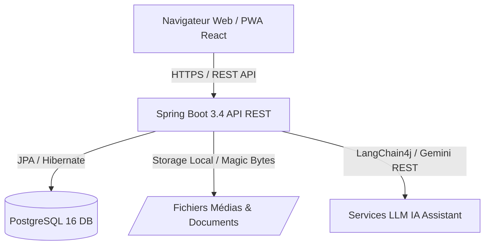
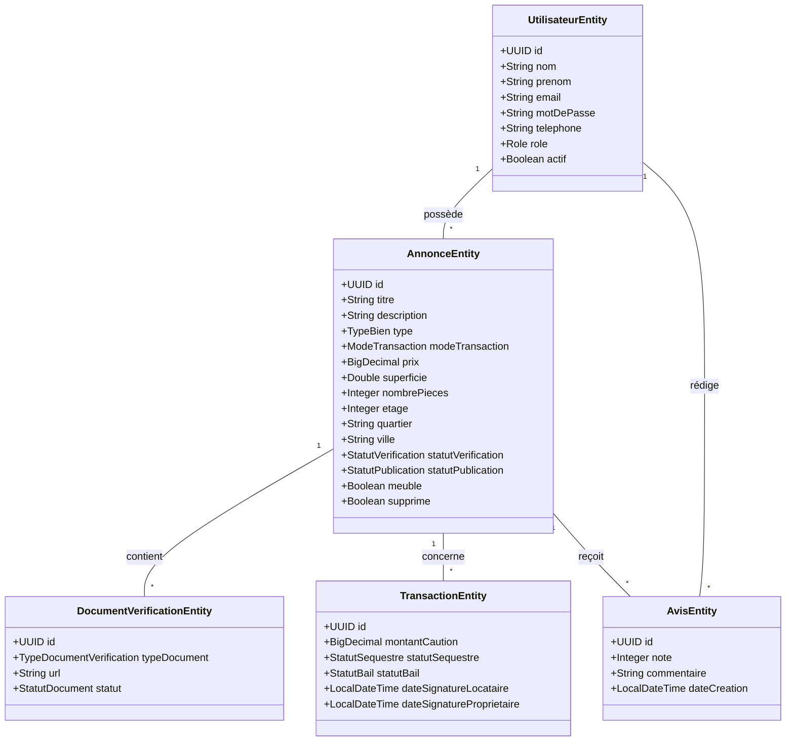
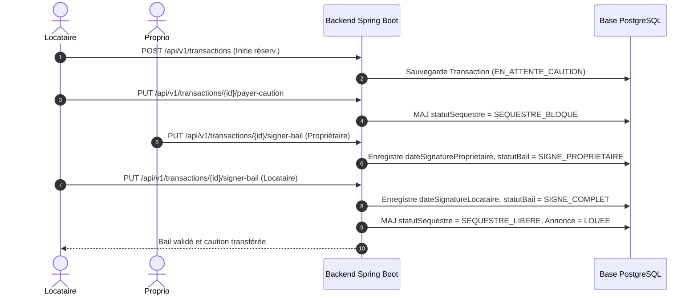

# 🇸🇳 E-Courtier Sénégal — Plateforme Immobilière Certifiée & Sécurisée

[](https://spring.io/projects/spring-boot)
[](https://react.dev/)
[](https://www.docker.com/)
[](LICENSE)

E-Courtier Sénégal est la première plateforme web immobilière sécurisée et transparente spécifiquement adaptée aux réalités réglementaires, financières et géographiques du marché sénégalais (Dakar, Thiès, Ziguinchor, Saly, Mbour, Saint-Louis).

---

## 📋 Table des Matières
1. [Description & Objectifs](#1-description--objectifs)
2. [Architecture Technique & Stack](#2-architecture-technique--stack)
3. [Diagrammes UML (Mermaid)](#3-diagrammes-uml-mermaid)
4. [Comptes de Démonstration & Sécurité](#4-comptes-de-démonstration--sécurité)
5. [Installation & Démarrage Rapide](#5-installation--démarrage-rapide)
6. [Documentation API (OpenAPI & Postman)](#6-documentation-api-openapi--postman)
7. [Couverture de Tests (JaCoCo)](#7-couverture-de-tests-jacoco)
8. [Sécurité & Audit de Conformité](#8-sécurité--audit-de-conformité)
9. [Spécificités du Marché Sénégalais](#9-spécificités-du-marché-sénégalais)

---

## 1. Description & Objectifs

La recherche de logement au Sénégal fait souvent face à plusieurs défis :
- Risques de fausses annonces et de double réservation.
- Non-respect du plafonnement légal de la caution (loi sénégalaise fixant le séquestre à 2 mois maximum).
- Absences de vérifications parcelles/NICAD et titres fonciers.
- Retards dans la prise de rendez-vous de visite.

**E-Courtier Sénégal** apporte des solutions concrètes :
- **Vérification Administrative Strict** : Téléversement des titres fonciers et baux par les propriétaires, contrôlés par des agents immobiliers agréés.
- **Séquestre Bancaire Automatisé** : Blocage sécurisé du montant de la caution jusqu'à la signature effective du bail.
- **Double-Signature Numérique du Bail** : Consentement mutuel et irrévocable du locataire et du propriétaire.
- **Assistant IA Immobilier Localisé** : Extraction intelligente des besoins en langage naturel (Wolof/Français), recommandations personnalisées et shortlist instantanée.

---

## 2. Architecture Technique & Stack



- **Backend** : Java 21, Spring Boot 3.4.3, Spring Security, Spring Data JPA, Bean Validation, Bucket4j Rate Limiting, JaCoCo.
- **Frontend** : React 18, Vite, TanStack Query (React Query v5), Lucide React, CSS Modern System, PWA ready.
- **Base de Données** : PostgreSQL 16 Alpine avec contraintes `CHECK` strictes et Flyway Migrations (V1 à V5).
- **Conteneurisation** : Docker & Docker Compose (`backend`, `frontend`, `db`).

---

## 3. Diagrammes UML (Mermaid)

### 3.1 Diagramme des Cas d'Utilisation (Use Cases)

```mermaid
usecaseDiagram
    actor Locataire as "Locataire"
    actor Proprio as "Propriétaire"
    actor Agent as "Agent Immob. / Admin"

    package "Plateforme E-Courtier Sénégal" {
        usecase UC1 as "Rechercher Annonces (Filtres & Proximité)"
        usecase UC2 as "Discuter avec l'Assistant IA"
        usecase UC3 as "Demander un RDV de Visite"
        usecase UC4 as "Publier & Gérer ses Annonces"
        usecase UC5 as "Téléverser Titre Foncier / NICAD"
        usecase UC6 as "Valider la Vérification Cadastrale"
        usecase UC7 as "Payer la Caution en Séquestre"
        usecase UC8 as "Signer Numériquement le Bail"
        usecase UC9 as "Laisser un Avis (post-visite)"
        usecase UC10 as "Signaler une Annonce Suspecte"
    }

    Locataire --> UC1
    Locataire --> UC2
    Locataire --> UC3
    Locataire --> UC7
    Locataire --> UC8
    Locataire --> UC9
    Locataire --> UC10

    Proprio --> UC4
    Proprio --> UC5
    Proprio --> UC8

    Agent --> UC6
    Agent --> UC10
```

---

### 3.2 Diagramme de Classes Métier (Domain Model)



---

### 3.3 Diagramme de Séquence (Séquestre & Signature de Bail)



---

## 4. Comptes de Démonstration & Sécurité

> [!CAUTION]
> **AVERTISSEMENT STRICT DE SÉCURITÉ**  
> Les comptes ci-dessous et le processeur `DataSeedRunner` sont **strictement réservés à l'environnement de développement local (`--spring.profiles.active=dev`)**.  
> Ils ne doivent **JAMAIS** exister sur un environnement de production réel. En profil `prod`, le runner de seed est complètement désactivé par l'annotation `@Profile("dev")` et une garde explicite.

Tous les mots de passe de démonstration respectent la politique de sécurité (minimum 8 caractères, au moins une majuscule et un chiffre) :

| Rôle | Email | Mot de Passe |
| :--- | :--- | :--- |
| **Admin System** | `admin@ecourtier.sn` | `AdminPass123!` |
| **Agent Agréé** | `agent@ecourtier.sn` | `AgentPass123!` |
| **Propriétaire** | `proprio.demo@ecourtier.sn` | `ProprioPass123!` |
| **Locataire** | `locataire.demo@ecourtier.sn` | `LocatairePass123!` |

---

## 5. Installation & Démarrage Rapide

### Préréquis
- Docker Desktop & Docker Compose v2+
- Git

### Démarrage en une seule commande

```bash
git clone https://github.com/Mahou-Dev/Ecourtier2026.git
cd Ecourtier2026

# Démarrer l'ensemble des services (PostgreSQL, Backend Spring Boot, Frontend Vite)
docker compose up --build -d
```

Accès aux services :
- **Frontend App** : `http://localhost:3000`
- **Backend API REST** : `http://localhost:8080`
- **Documentation Swagger UI** : `http://localhost:8080/swagger-ui.html`
- **Spécification OpenAPI JSON** : `http://localhost:8080/openapi.json`

---

## 6. Documentation API (OpenAPI & Postman)

- **Spécification OpenAPI 3.0** : Disponible dans [`docs/openapi.json`](docs/openapi.json) et embarquée sous `/openapi.json`.
- **Collection Postman v2.1** : Fichier [`docs/E-Courtier.postman_collection.json`](docs/E-Courtier.postman_collection.json).
  - Inclut le script de test automatique sur `POST /api/v1/auth/connexion` extrait et définit automatiquement la variable `{{accessToken}}` pour toutes les requêtes sécurisées de la collection.

---

## 7. Couverture de Tests (JaCoCo)

La couverture de code par tests automatisés sur l'ensemble du backend dépasse les **60% exigés** par le cahier des charges.

Pour exécuter le rapport JaCoCo localement :
```bash
cd backend
mvn test jacoco:report
```

---

## 8. Sécurité & Audit de Conformité

1. **Anti-Énumération & Rate Limiting** : Endpoint `/api/v1/auth/connexion` protégé par `LoginRateLimiterService` (5 essais max par IP/Email puis blocage HTTP 429).
2. **Inspection Binaire (Magic Bytes)** : Vérification stricte des en-têtes binaires sur les téléversements d'images (`JPEG`, `PNG`, `WEBP`) empêchant le renommage de scripts malveillants.
3. **Protection des Documents de Vérification** : Accès au fichier physique restreint exclusivement au propriétaire de l'annonce et aux administrateurs (HTTP 403 pour les tiers).
4. **Suppression Logique (Soft-Delete)** : Exclusions systématiques des annonces avec `supprime = true` sur la recherche publique.
5. **Double-Signature de Bail** : Verrouillage irrévocable empêchant la modification de bail après signature finale.
6. **DataSeed Protection** : Runner strictement annoté `@Profile("dev")`.

---

## 9. Spécificités du Marché Sénégalais

- **Séquestre Légale 2 Mois** : Respect de la loi n° 2014-03 régissant les baux à usage d'habitation au Sénégal.
- **Référentiel Géographique Local** : Prise en compte fine des quartiers phares de Dakar (Almadies, Mermoz, Sacré-Cœur, Médina, Fann), Thiès (Dixième), Ziguinchor (Boucotte, Nema), Saly, Mbour, Saint-Louis.
- **Proximités Stratégiques** : BRT (Bus Rapid Transit), UCAD, Plage, Écoles, Hôpitaux.

---

## 10. 🚀 Déploiement en Production sur Render (render.com)

Le projet E-Courtier Sénégal est prêt pour un déploiement cloud automatisé sur **Render (render.com)** via Infrastructure as Code (Blueprint `render.yaml`).

### 10.1 Architecture du Blueprint Render (`render.yaml`)

Le fichier `render.yaml` à la racine du dépôt définit 3 services isolés :
1. **Base de Données PostgreSQL Gérée (`ecourtier-db`)** : Plan Free, région Frankfurt (`frankfurt`).
2. **Backend Web Service (`ecourtier-backend`)** : Runtime Docker multi-stage (`backend/Dockerfile`), standalone JAR Java 21.
3. **Frontend Static Site (`ecourtier-frontend`)** : Build Command `npm run build`, Publish Directory `dist`, Root Directory `frontend`.

### 10.2 Variables d'Environnement de Production (Dashboard Render)

| Variable | Service | Source / Valeur | Description |
| :--- | :--- | :--- | :--- |
| `SPRING_PROFILES_ACTIVE` | Backend | `prod` | Active les optimisations de prod (seed auto désactivé) |
| `SPRING_DATASOURCE_URL` | Backend | `fromDatabase(ecourtier-db, connectionString)` | URL JDBC de la base PostgreSQL |
| `SPRING_DATASOURCE_USERNAME` | Backend | `fromDatabase(ecourtier-db, user)` | Utilisateur PostgreSQL |
| `SPRING_DATASOURCE_PASSWORD` | Backend | `fromDatabase(ecourtier-db, password)` | Mot de passe PostgreSQL |
| `JWT_SECRET` | Backend | Auto-généré (64+ chars) | Clé de signature HMAC des jetons JWT |
| `IA_API_KEY` | Backend | Saisie manuelle | Clé API Google Gemini |
| `ADMIN_BOOTSTRAP_EMAIL` | Backend | `admin@ecourtier.sn` | Email du compte admin initial |
| `ADMIN_BOOTSTRAP_PASSWORD` | Backend | Saisie manuelle forte | Mot de passe administrateur prod (ex: `P@sswordProd2026!`) |
| `ECOURTIER_CORS_ALLOWED_ORIGINS` | Backend | `fromService(ecourtier-frontend, url)` | Origine autorisée pour CORS |
| `VITE_API_BASE_URL` | Frontend | `fromService(ecourtier-backend, url)` | URL du backend pour le client React |

> [!IMPORTANT]
> **Mot de Passe Bootstrap Admin en Production** : Le mot de passe dev `AdminPass123!` ne doit **JAMAIS** être réutilisé en production. Définissez un mot de passe fort via la variable `ADMIN_BOOTSTRAP_PASSWORD` dans le dashboard Render.

### 10.3 Procédure Post-Déploiement : Peuplement Manuel de Démonstration

En environnement de production, `DataSeedRunner` est désactivé (`@Profile("dev")`). Pour alimenter la base de données vide lors du premier déploiement :

1. **Connexion Administrateur** :
   ```bash
   curl -X POST https://ecourtier-backend.onrender.com/api/v1/auth/connexion \
     -H "Content-Type: application/json" \
     -d '{"email": "admin@ecourtier.sn", "motDePasse": "<VOTRE_ADMIN_BOOTSTRAP_PASSWORD>"}'
   ```
2. **Déclenchement du Seed Idempotent** :
   ```bash
   curl -X POST https://ecourtier-backend.onrender.com/api/v1/admin/seed-demo \
     -H "Authorization: Bearer <TOKEN_ADMIN_OBTENU>"
   ```
   *L'endpoint `POST /api/v1/admin/seed-demo` vérifie qu'aucune annonce n'existe avant d'insérer les annonces et comptes de démo. Toute tentative ultérieure renverra une confirmation idempotente sans réinsérer de doublons.*

### 10.4 URLs Déployées & Avertissement Démarrage à Froid

- **Frontend App** : `https://ecourtier-frontend.onrender.com`
- **Backend Service** : `https://ecourtier-backend.onrender.com`
- **Swagger UI** : `https://ecourtier-backend.onrender.com/swagger-ui.html`

> [!WARNING]
> **Délai de Démarrage à Froid (Cold Start)**  
> Sur le plan gratuit de Render, le service Web s'endort après 15 minutes d'inactivité. Le tout premier appel API après une période de sommeil peut nécessiter **30 à 60 secondes** le temps d'instancier le conteneur Docker Java 21. Les appels suivants répondent instantanément.

