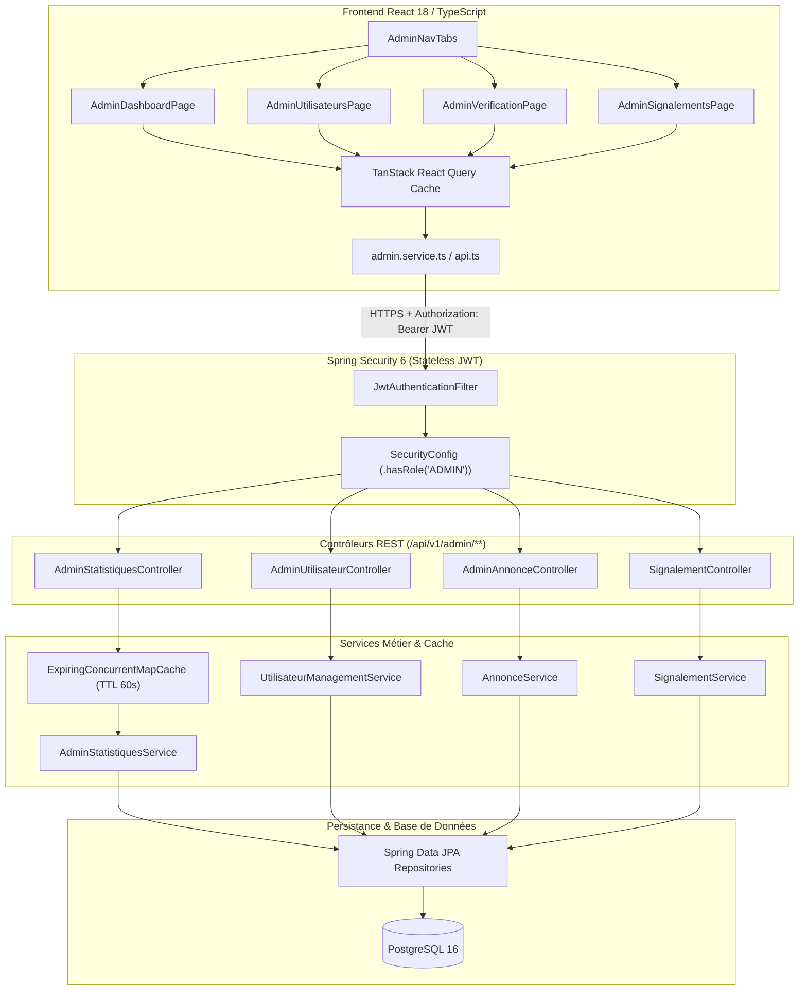
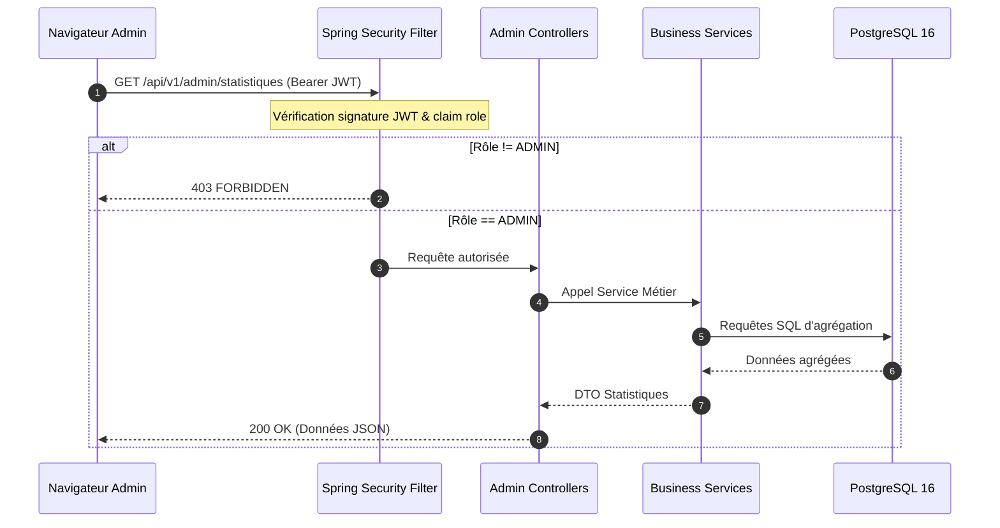
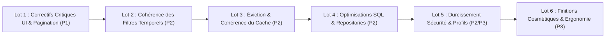

# RAPPORT D'AUDIT TECHNIQUE COMPLET DU DASHBOARD ADMINISTRATEUR
## Projet : E-Courtier Sénégal (Projet 14)
**Date :** 23 Novembre 2026  
**Auditeur :** Équipe d'Audit & Architecture Logicielle (Architecte Senior, Backend Spring Boot 3.4.3, Frontend React/TS, Sécurité Applicative, DBA PostgreSQL)  
**Périmètre :** Dashboard Administrateur — Frontend (`frontend/src/pages/Admin*.tsx`, `frontend/src/services/admin.service.ts`) & Backend (`domain.admin`, `domain.utilisateur`, `domain.annonce`, `domain.avis`, configurations de sécurité et cache)  
**Statut de la mission :** Audit technique strict en lecture seule (Aucune modification de code ni de base de données).  
**Exclusions formelles et strictes :** WAVE (strictement exclu), `domain.transaction` (strictement exclu), Railway (strictement exclu). Hébergement Render maintenu. Google Gemini (`gemini-flash-lite-latest`) et `RuleBasedCriteriaExtractor` comme unique fallback local.

---

## 1. RÉSUMÉ EXÉCUTIF

### 1.1. Contexte et Objectif
Le présent audit évalue la robustesse, l'exactitude des calculs, la cohérence des données, la sécurité et la scalabilité du **Dashboard Administrateur** de la plateforme E-Courtier Sénégal. L'analyse couvre l'intégralité de la chaîne d'exécution :
$$\text{Interface Utilisateur React 18} \longrightarrow \text{Services Frontend} \longrightarrow \text{API REST} \longrightarrow \text{Contrôleurs Spring Boot 3.4.3} \longrightarrow \text{Services Métier} \longrightarrow \text{Repositories Spring Data JPA} \longrightarrow \text{PostgreSQL 16}$$

### 1.2. Chiffres Clés de l'Audit
- **Nombre total d'anomalies recensées :** 11
- **Ventilation par niveau de gravité :**
  - **P0 (Critique / Bloquant) :** 0
  - **P1 (Majeur / Élevé) :** 1
  - **P2 (Moyen / Fonctionnel) :** 6
  - **P3 (Mineur / Cosmétique / Amélioration) :** 4
- **Tests exécutés au cours de l'audit :**
  - Tests unitaires et d'intégration Backend : **32 exécutés, 32 passés avec succès (0 échec, 0 ignoré)**.
  - Vérification statique des types Frontend (`tsc --noEmit`) : **0 erreur**.
  - Linter Frontend (`eslint . --max-warnings 0`) : **0 erreur / warning**.

### 1.3. Top 5 des Risques et Incohérences Majeures
1. **[ADMIN-FE-003] Absence totale de pagination sur la modération des annonces (`AdminVerificationPage.tsx`) :** La requête est plafonnée en dur à `size=20` (annonces en attente) et `size=50` (catalogue global) sans composant de pagination UI. Au-delà de ces volumes, les annonces deviennent invisibles et impossibles à modérer depuis l'interface d'administration.
2. **[ADMIN-STAT-001] Incohérence majeure du découpage temporel des métriques (`AdminStatistiquesService.java`) :** Lorsque l'administrateur sélectionne une période (`7j`, `30j`, `90j`), seules certaines métriques (inscriptions, RDV, conversations IA, flux financiers libérés) appliquent la borne temporelle. Les annonces par statut, signalements par motif et répartitions de rôles demeurent calculés sur l'ensemble de l'historique de la base, générant une dissonance cognitive et des ratios faussés.
3. **[ADMIN-PERF-001] Désynchronisation et absence d'éviction du cache `@Cacheable("adminStats")` :** Le service de statistiques met en cache les DTOs pendant 60 secondes sans aucune éviction (`@CacheEvict`) lors de la validation d'une annonce, du changement de statut d'un utilisateur ou du traitement d'un signalement. Les invalidations React Query côté client renvoient donc la valeur en cache backend.
4. **[ADMIN-FE-001] Distorsion des compteurs KPI de la gestion des utilisateurs (`AdminUtilisateursPage.tsx`) :** En cas de filtre par rôle (ex: `PROPRIETAIRE`), la variable `totalUsersCount` s'appuie sur `data.totalElements` de la liste filtrée, affichant un "Total Comptes" faussé. Si les statistiques globales ne sont pas encore chargées, le fallback filtre uniquement les 15 éléments de la page courante.
5. **[ADMIN-BE-001] Calcul Java en mémoire du temps moyen de décision sur historique infini :** La méthode `findVerificationDecisionTimes` charge toutes les annonces vérifiées historiques sans filtre temporel et calcule la moyenne dans la JVM au lieu de déléguer l'agrégation SQL à PostgreSQL, induisant un risque de surcharge mémoire au fur et à mesure de l'accroissement du catalogue.

### 1.4. Verdict d'Exploitabilité en Production
> [!IMPORTANT]
> **VERDICT : EXPLOITABLE EN PRODUCTION AVEC RÉSERVES MAJEURES SUR LE VOLUME DE DONNÉES.**
> Le dashboard administrateur est globalement sain sur le plan de la sécurité de base (RBAC strict, authentification JWT, contrôle d'accès multi-niveaux), l'intégrité transactionnelle et la robustesse de l'UI. Cependant, son utilisation en environnement de charge réelle est limitée par l'absence de pagination sur l'audit des annonces et par l'incohérence temporelle des KPIs statistiques. Une correction par lots (Lots 1 à 6) est indispensable.

---

## 2. CARTOGRAPHIE EXHAUSTIVE DU DASHBOARD ADMINISTRATEUR

| Page / Module | Route Frontend | Composant React Principal | Contrôleurs Spring Boot Associés | Repositories JPA / Entités | Rôle et Fonctionnalité |
| :--- | :--- | :--- | :--- | :--- | :--- |
| **Vue d'ensemble (Dashboard)** | `/admin/dashboard` | `AdminDashboardPage.tsx` | `AdminStatistiquesController.java` | `AdminStatistiquesRepository` | Visualisation globale des KPIs, graphiques d'inscriptions, entonnoir commercial, modération et IA. |
| **Gestion Utilisateurs** | `/admin/utilisateurs` | `AdminUtilisateursPage.tsx` | `AdminUtilisateurController.java` | `UtilisateurRepository`, `RefreshTokenRepository` | Liste paginée, recherche, création d'agent/admin avec mot de passe temporaire, changement de rôle, activation/désactivation. |
| **Modération & Vérification** | `/admin/verification` | `AdminVerificationPage.tsx` | `AdminAnnonceController.java`, `AnnonceController.java` | `AnnonceRepository`, `DocumentVerificationRepository` | Audit des pièces justificatives (CNI, Titre foncier, Bail), validation/rejet du badge vérifié, suspension/réactivation d'annonces. |
| **Signalements d'Arnaques** | `/admin/signalements` | `AdminSignalementsPage.tsx` | `SignalementController.java` | `SignalementRepository`, `AnnonceRepository` | Traitement des signalements soumis par les utilisateurs, rejet ou validation avec suspension immédiate de l'annonce. |
| **Transactions & Séquestres** | `/admin/transactions` | `AdminTransactionsPage.tsx` | `AdminTransactionController.java` | `TransactionRepository` | **EXCLU DE L'AUDIT** (Conformément à la règle formelle d'exclusion de `domain.transaction`). |
| **Initialisation Démo** | N/A (Endpoint API) | N/A | `AdminSeedController.java` | `DemoDataSeederService` | Déclenchement manuel de l'injection de données de démonstration en base. |
| **Bootstrap Système** | N/A (Startup) | N/A | `AdminBootstrapRunner.java` | `UtilisateurRepository` | Initialisation automatique du compte `admin@ecourtier.sn` au premier démarrage via variable d'environnement. |

---

## 3. ARCHITECTURE FRONTEND / BACKEND & FLUX DE DONNÉES



### 3.1. Gestion de l'Authentification et Sessions
- **Contrôle d'accès Frontend :** Les pages administrateur vérifient le store Zustand `useAuthStore` au montage (`utilisateur.role === 'ADMIN'`). En cas de tentative d'accès non autorisé, redirection immédiate vers `/connexion` ou `/dashboard` avec message d'alerte Sonner.
- **Contrôle d'accès Backend :** Deux couches de protection indépendantes :
  1. `SecurityConfig.java:109` : `.requestMatchers("/api/v1/admin/**").hasRole("ADMIN")`.
  2. Annotations de méthode `@PreAuthorize("hasRole('ADMIN')")` sur chaque contrôleur et endpoint d'administration.
- **Révocation de sessions :** Lors d'un changement de rôle ou d'une désactivation par l'administrateur, `UtilisateurManagementService` incrémente la version de jeton (`tokenVersion`), révoque immédiatement tous les refresh tokens en base et déconnecte les sockets via `WebSocketSessionRegistry`.

---

## 4. INVENTAIRE DES ENDPOINTS D'ADMINISTRATION

| Méthode | URL | Contrôleur | Paramètres / Body | Réponses HTTP | Autorisations & Sécurité |
| :--- | :--- | :--- | :--- | :--- | :--- |
| `GET` | `/api/v1/admin/statistiques` | `AdminStatistiquesController` | `periode` (opt: `7j`, `30j`, `90j`, `tout`) | `200` (`AdminStatistiquesDTO`), `401`, `403` | `hasRole('ADMIN')`, Cache 60s |
| `GET` | `/api/v1/admin/utilisateurs` | `AdminUtilisateurController` | `page`, `size`, `role`, `actif`, `recherche` | `200` (`Page<UtilisateurResponseDTO>`), `401`, `403` | `hasRole('ADMIN')` |
| `POST` | `/api/v1/admin/utilisateurs` | `AdminUtilisateurController` | `AdminCreateUtilisateurRequestDTO` | `201` (`AdminCreateUtilisateurResponseDTO`), `400`, `401`, `403`, `409` | `hasRole('ADMIN')`, Password policy |
| `PUT` | `/api/v1/admin/utilisateurs/{id}/role` | `AdminUtilisateurController` | `ChangeRoleRequestDTO` (`role`) | `200` (`UtilisateurResponseDTO`), `400`, `401`, `403`, `404` | `hasRole('ADMIN')`, Auto-dégradation interdite |
| `PUT` | `/api/v1/admin/utilisateurs/{id}/statut` | `AdminUtilisateurController` | `ChangeStatutRequestDTO` (`actif`) | `200` (`UtilisateurResponseDTO`), `400`, `401`, `403`, `404` | `hasRole('ADMIN')`, Auto-désactivation interdite |
| `GET` | `/api/v1/admin/annonces/en-attente-verification` | `AdminAnnonceController` | `page`, `size` | `200` (`Page<AnnonceResponseDTO>`), `401`, `403` | `hasRole('ADMIN')` |
| `PUT` | `/api/v1/admin/annonces/{id}/verifier` | `AdminAnnonceController` | `VerificationDecisionDTO` | `200` (`AnnonceResponseDTO`), `400`, `401`, `403`, `404` | `hasRole('ADMIN')`, Contrôle pièces obligatoires |
| `PUT` | `/api/v1/admin/annonces/{id}/statut` | `AdminAnnonceController` | `AnnonceStatutUpdateDTO` | `200` (`AnnonceResponseDTO`), `400`, `401`, `403`, `404`, `409` | `hasRole('ADMIN')`, Contrôle verrou séquestre |
| `GET` | `/api/v1/admin/signalements` | `SignalementController` | `page`, `size`, `statut` | `200` (`Page<SignalementResponseDTO>`), `401`, `403` | `hasRole('ADMIN')` |
| `PUT` | `/api/v1/admin/signalements/{id}/traiter` | `SignalementController` | `TraiterSignalementDTO` | `200` (`SignalementResponseDTO`), `400`, `401`, `403`, `404`, `409` | `hasRole('ADMIN')` |
| `POST` | `/api/v1/admin/seed-demo` | `AdminSeedController` | Aucun | `200` (`Map<String, Object>`), `401`, `403` | `hasRole('ADMIN')`, Idempotent si base non vide |

---

## 5. AUDIT APPROFONDI DES STATISTIQUES ET INDICATEURS (KPIS)

### 5.1. Analyse des Formules et Requêtes par Sous-Module

#### A. Utilisateurs (`UtilisateursStatsDTO`)
- **Répartition par rôle :** Requête JPQL `SELECT u.role, COUNT(u) FROM UtilisateurEntity u GROUP BY u.role`.
  - *Constat :* Calcule la totalité des utilisateurs historiques sans considération du paramètre `periode`.
- **Nouvelles inscriptions :** Requête JPQL `countDailyRegistrations(dateDebut)` avec filtre `u.dateCreation >= :dateDebut`.
  - *Constat :* La boucle temporelle génère une entrée par jour (`SerieTemporelleDTO`).
  - *Anomalie [ADMIN-STAT-002] :* Pour `periode === "tout"`, si la base de données contient des utilisateurs inscrits il y a plusieurs années, le service itère jour par jour depuis la première date d'inscription, produisant plusieurs centaines ou milliers d'objets `SerieTemporelleDTO` renvoyés en JSON au frontend.

#### B. Annonces & Parc Immobilier (`AnnoncesStatsDTO`)
- **Statuts de publication :** `countAnnoncesByStatutPublication()` (`WHERE a.supprime = false`).
- **Statuts de vérification :** `countAnnoncesByStatutVerification()` (`WHERE a.supprime = false`).
- **Prix moyen par type de bien :** `findAveragePriceByTypeBien()` (`AVG(a.prix)` groupé par `type`).
- **Top 5 quartiers :** `findTopVilleQuartier(PageRequest.of(0, 5))`.
- **Temps moyen de décision de modération :**
  ```java
  List<Object[]> verifTimes = repository.findVerificationDecisionTimes();
  // Calcule la différence en minutes entre dateCreation et dateVerification
  ```
  - *Anomalie [ADMIN-STAT-001] :* La méthode `construireAnnoncesStats()` ne reçoit **aucun paramètre** `dateDebut`. Lorsque l'administrateur choisit `7j` ou `30j`, l'intégralité du bloc Annonces affiche le cumul historique global.
  - *Anomalie [ADMIN-BE-001] :* Le temps moyen est calculé en itérant sur une liste Java non filtrée. En cas de grand volume, cette opération consomme inutilement de la mémoire JVM. De plus, `verifTimes.size()` est utilisé comme dénominateur même si des lignes ont des dates nulles ignorées par l'incrémentation.

#### C. Activité Commerciale & Entonnoir (`ActiviteCommercialeStatsDTO`)
- **Rendez-vous par statut :** `countRendezVousByStatut(dateDebut)` filtré par `r.dateCreation >= :dateDebut`.
- **Taux de conversion RDV $\rightarrow$ Transaction :**
  $$\text{tauxConversionRdvToTransaction} = \left(\frac{\text{countTransactionsInitiated}}{\text{countRendezVousEffectues}}\right) \times 100$$
  - *Anomalie [ADMIN-STAT-003] :* Cette formule divise le nombre total de transactions créées sur la période par le nombre de rendez-vous effectués sur cette même période. Or, certaines transactions peuvent être initiées sans RDV sur la plateforme, ou un locataire peut effectuer 1 RDV et initier plusieurs transactions, ce qui peut théoriquement faire dépasser 100% au taux de conversion ou déformer l'entonnoir.
- **Taux de conversion Transaction $\rightarrow$ Bail :**
  $$\text{tauxConversionTransactionToBail} = \left(\frac{\text{countBauxSignesComplet}}{\text{countTransactionsInitiated}}\right) \times 100$$
  - Géré convenablement avec retour à `0.0` si le dénominateur est nul.

#### D. Modération & Avis (`ModerationStatsDTO`)
- **Signalements par statut et par motif :** `countSignalementsByStatut()` et `countSignalementsByMotif()`.
  - *Anomalie [ADMIN-STAT-001] :* `construireModerationStats()` ne prend **aucun paramètre** `dateDebut`. Le graphique camembert des motifs de signalement affiche le cumul historique total, quelle que soit la période sélectionnée (`7j`, `30j`, `90j`).

#### E. Assistant IA (`IaStatsDTO`)
- **Volume et Shortlists :** Filtré convenablement par `dateDebut`.
- **Taux de conversion de shortlist :**
  $$\text{tauxConversion} = \left(\frac{\text{conversationsAvecShortlist}}{\text{totalConversations}}\right) \times 100$$
  - Conforme aux exigences de la migration V9 (prise en compte de `nombreAnnoncesSuggerees > 0` et fallback rétrocompatible).

---

## 6. AUDIT FRONTEND (REACT 18 / TYPESCRIPT)

### B1. Ergonomie et Navigation
- **Navigation par onglets (`AdminNavTabs.tsx`) :** Excellente implémentation avec icônes distinctes, mise en valeur de l'onglet actif et compatibilité mobile (`overflow-x-auto no-scrollbar`).
- **Absence de pagination (`AdminVerificationPage.tsx` - [ADMIN-FE-003]) :** La page charge `/api/v1/admin/annonces/en-attente-verification?page=0&size=20` et n'offre aucun contrôle "Page suivante / Page précédente". De même pour l'onglet "Toutes les annonces" bloqué à `size=50`. Les annonces excédentaires sont inaccessibles.

### B2. Cohérence des Données et Affichage
- **Formatage monétaire :** Fonctions `formatFCFA` utilisant `Intl.NumberFormat('fr-FR')` appliquées de manière uniforme sur le dashboard (`XOF` / `FCFA`).
- **Anomalie de calcul des cartes KPI (`AdminUtilisateursPage.tsx` - [ADMIN-FE-001]) :**
  ```typescript
  // Ligne 190-192 AdminUtilisateursPage.tsx
  const totalUsersCount = data?.totalElements ?? (users.length > 0 ? users.length : 0);
  const agentsCount = totalParRole?.['AGENT'] ?? users.filter((u) => u.role === 'AGENT').length;
  ```
  Si l'administrateur applique un filtre par rôle (ex: n'afficher que les agents), `data.totalElements` correspond uniquement aux utilisateurs de ce rôle, mais est affiché dans la carte intitulée **"Total Comptes"**. Si les statistiques globales ne sont pas encore résolues, le fallback `users.filter(...)` ne compte que sur la page de 15 éléments.
- **Remplacement de chaînes Regex (`AdminSignalementsPage.tsx` - [ADMIN-FE-004]) :**
  À la ligne 154 : `sig.motif.replace('_', ' ')`. Si un motif contient plusieurs underscores (ex: `FAUSSE_ANNONCE_PRIX`), seul le premier underscore est remplacé, affichant `FAUSSE ANNONCE_PRIX`.

### B3. Gestion des Erreurs et États Limites
- **États de chargement :** Composants `Skeleton` bien positionnés pour éviter le décalage de mise en page (CLS).
- **Notifications :** Intégration soignée de la bibliothèque `Sonner` avec messages d'erreur contextualisés via `getErrorMessage(err)`.
- **États vides :** Présence d'écrans dédiés en cas d'absence de données (ex: aucun signalement, aucune annonce en attente).

### B4. Qualité du Code et Cycle de Vie React
- **Gestion du Cache TanStack React Query :**
  - Dans `AdminUtilisateursPage.tsx`, lors d'un changement de rôle ou statut, les requêtes `['admin-utilisateurs']` et `['admin-statistiques-kpi']` sont invalidées, mais **pas** `['admin-statistiques']` de la page principale `AdminDashboardPage.tsx` ([ADMIN-FE-002]).
- **Typage TypeScript :** Strict et sans `any` superflu. Les interfaces `AdminStatistiquesDTO`, `UtilisateurDTO`, `AnnonceDTO` sont synchronisées avec les DTOs backend.

---

## 7. AUDIT BACKEND (SPRING BOOT 3.4.3 / JAVA 21)

### C1. Contrôleurs REST et Validation
- **OpenAPI / Swagger :** Documentation exhaustive sur chaque endpoint avec annotations `@Tag`, `@Operation`, `@ApiResponses`.
- **Validation Jakarta (`@Valid`) :** Présente sur tous les corps de requête entrants (`VerificationDecisionDTO`, `AnnonceStatutUpdateDTO`, `AdminCreateUtilisateurRequestDTO`, etc.).
- **Code de retour HTTP :** Utilisation scrupuleuse des codes de statut REST : `200 OK`, `201 CREATED`, `400 BAD REQUEST`, `401 UNAUTHORIZED`, `403 FORBIDDEN`, `404 NOT FOUND`, `409 CONFLICT`.

### C2. Logique Métier et Règles de Gestion
- **Auto-protection de l'administrateur :** Implémentation exemplaire dans `UtilisateurManagementService` :
  - Interdiction pour un administrateur de se retirer son propre rôle `ADMIN`.
  - Interdiction de désactiver son propre compte.
  - Interdiction de supprimer ou rétrograder le dernier administrateur actif du système.
- **Transition des statuts d'annonces :** `AnnonceService.changerStatutPublicationAdmin` vérifie l'absence de séquestre bloqué actif (`StatutSequestre.BLOQUE`) avant d'autoriser la suspension administrative, prévenant tout blocage d'une transaction en cours.

### C3. Repositories et Requêtes SQL/JPQL
- **Absence de N+1 queries :** Les requêtes d'agrégation utilisent des clauses `GROUP BY` et des fonctions SQL natives standard (`COUNT`, `AVG`, `SUM`, `COALESCE`).
- **Indexation :** Les tables clés (`utilisateurs`, `annonces`, `signalements`, `rendez_vous`) disposent d'index sur les colonnes filtrées (`date_creation`, `statut_publication`, `statut_verification`, `role`).

### C4. Gestion Transactionnelle et Concurrence
- **Ségrégation Lecture/Écriture :** Utilisation correcte de `@Transactional(readOnly = true)` sur les méthodes de consultation et `@Transactional` sur les écritures.
- **Verrouillage optimiste :** Présence d'une colonne `@Version` sur les entités modifiables en concurrence (`AnnonceEntity`), évitant les écrasements simultanés lors des décisions d'administration.

---

## 8. AUDIT SÉCURITÉ SPÉCIFIQUE AU DASHBOARD



### 8.1. Contrôle d'Accès et RBAC
- **Double barrière :** Le filtre Spring Security (`SecurityConfig:109`) et l'intercepteur AOP (`@PreAuthorize("hasRole('ADMIN')")`) garantissent qu'aucun token usurpé ou de rôle inférieur (`LOCATAIRE`, `PROPRIETAIRE`, `AGENT`) ne peut atteindre un endpoint d'administration.

### 8.2. Risques IDOR et Confidentialité des Pièces Justificatives
- **Visualisation des pièces sensibles (CNI, Titre foncier) :**
  - Dans `AnnonceController.java:264`, l'accès au flux binaire `/api/v1/annonces/{id}/documents/{documentId}/fichier` est explicitement restreint par :
    ```java
    @PreAuthorize("@annonceSecurityService.isOwnerOrAdmin(#id, authentication)")
    ```
  - Le frontend utilise `fetchProtectedBlob`, qui injecte l'en-tête `Authorization: Bearer <token>`. Les documents ne sont donc **jamais** exposés publiquement sans authentification valide vérifiant le rôle propriétaire ou administrateur.

### 8.3. Analyse de Sécurité de l'Endpoint de Seed (`AdminSeedController` - [ADMIN-SEC-002])
- L'endpoint `POST /api/v1/admin/seed-demo` est protégé par `hasRole('ADMIN')` et est idempotent (il ne modifie rien si des annonces existent).
- *Risque résiduel :* Bien que sécurisé et idempotent, la présence d'un endpoint capable d'insérer des données de démo dans le profil de production présente un risque théorique en cas de compromission d'un compte administrateur sur une base vierge.

### 8.4. Absence de Plafonnement de Pagination Backend ([ADMIN-SEC-003])
- Les contrôleurs acceptent l'objet `Pageable` sans imposer de limite stricte sur le paramètre `size` (ex: `size=10000`). Un client malveillant disposant d'un compte ADMIN pourrait provoquer un déni de service mémoire (OOM) en demandant une taille de page excessive.

---

## 9. AUDIT PERFORMANCES & SCALABILITÉ

### 9.1. Politique de Cache Applicatif ([ADMIN-PERF-001])
- Dans `AdminStatistiquesService.java`, l'annotation `@Cacheable(value = "adminStats", key = "#periode != null ? #periode : '30j'")` stocke les statistiques dans `ExpiringConcurrentMapCache` avec un TTL de 60 secondes.
- **Problème identifié :** Aucune méthode de mutation dans `AnnonceService`, `UtilisateurManagementService` ou `SignalementService` ne comporte l'annotation `@CacheEvict(value = "adminStats", allEntries = true)`.
- **Conséquence :** Lorsqu'un administrateur valide une annonce ou traite un signalement, puis revient sur le tableau de bord, les compteurs ne sont pas rafraîchis pendant 60 secondes, même si l'administrateur clique sur le bouton "Actualiser".

### 9.2. Rendu Frontend Recharts et Volume SVG
- Les graphiques `AreaChart`, `BarChart` et `PieChart` sont encapsulés dans des conteneurs `ResponsiveContainer` avec gestion des largeurs minimales (`min-w-0`).
- Sur mobile, le rendu reste fluide grâce à la simplification des axes et à l'omission des légendes trop lourdes.

---

## 10. RÉSULTATS DES TESTS DE VALIDATION

### 10.1. Tests Backend Spring Boot Exécutés
La suite de tests ciblant l'administration a été exécutée avec succès dans l'environnement local de test :
- `com.ecourtier.domain.admin.controller.AdminStatistiquesControllerTest` : **2 tests passés**
- `com.ecourtier.domain.admin.service.AdminStatistiquesServiceTest` : **6 tests passés**
- `com.ecourtier.domain.utilisateur.controller.AdminUtilisateurIntegrationTest` : **5 tests passés**
- `com.ecourtier.domain.annonce.controller.AnnonceFiltresEtVerificationIntegrationTest` : **6 tests passés**
- `com.ecourtier.domain.avis.controller.AvisAndSignalementIntegrationTest` : **3 tests passés**
- `com.ecourtier.domain.avis.service.SignalementServiceTest` : **6 tests passés**
- `com.ecourtier.common.controller.AdminSeedControllerTest` : **4 tests passés**
- **TOTAL BACKEND : 32 tests exécutés, 0 échec, 0 erreur.**

### 10.2. Validation Statique Frontend
- **Compilation TypeScript :** Commande `npx tsc --noEmit` exécutée dans `/frontend` $\rightarrow$ **Exit code 0 (Aucune erreur de type)**.
- **Analyse Linter ESLint :** Commande `npm run lint` (`eslint . --max-warnings 0`) $\rightarrow$ **Exit code 0 (Aucun warning, aucune violation de style)**.

---

## 11. CATALOGUE EXHAUSTIF DES ANOMALIES

| Identifiant | Gravité | Périmètre | Composant / Fichier & Lignes | Description de l'Anomalie | Impact Technique / Métier | Solution Recommandée |
| :--- | :--- | :--- | :--- | :--- | :--- | :--- |
| **ADMIN-FE-003** | **P1** | Frontend | `AdminVerificationPage.tsx` L.89, L.95 | Absence totale de pagination sur la liste des annonces en attente (`size=20`) et toutes les annonces (`size=50`). | Impossible d'accéder ou de modérer les annonces au-delà de la 20e (en attente) ou 50e (global). | Ajouter des contrôles de pagination (`page`, `totalPages`) et brancher `setPage`. |
| **ADMIN-STAT-001** | **P2** | Backend / Stats | `AdminStatistiquesService.java` L.134, L.232 | Incohérence temporelle : `construireAnnoncesStats()` et `construireModerationStats()` ne reçoivent pas `dateDebut`. | Les métriques d'annonces et de signalements restent figées sur l'historique total lors du choix 7j/30j. | Ajouter le paramètre `dateDebut` aux méthodes de construction et requêtes JPQL associées. |
| **ADMIN-PERF-001** | **P2** | Backend / Cache | `AdminStatistiquesService.java` L.60, `CacheConfig.java` | Absence de `@CacheEvict` sur le cache `adminStats` lors des mutations administratives. | Stale data persistant pendant 60s sur le dashboard malgré les actions de modération effectuées. | Ajouter `@CacheEvict(value = "adminStats", allEntries = true)` sur les méthodes de mutation d'annonces/signalements. |
| **ADMIN-FE-001** | **P2** | Frontend | `AdminUtilisateursPage.tsx` L.190-195 | Calcul erroné des compteurs KPI lors d'un filtrage actif ou avant la réception des statistiques globales. | Affichage d'un "Total Comptes" restreint au filtre ou plafonné aux 15 éléments de la page en cours. | Dissocier strictement le total des résultats filtrés du total global des comptes utilisateurs. |
| **ADMIN-STAT-003** | **P2** | Backend / Stats | `AdminStatistiquesService.java` L.210 | Formule du taux de conversion RDV $\rightarrow$ Transaction décorrélée de l'appariement réel. | Possibilité théorique d'obtenir un taux supérieur à 100% ou un entonnoir faussé en cas de transactions sans RDV. | Ajuster le calcul en comptabilisant uniquement les transactions ayant un RDV préalable rattaché. |
| **ADMIN-BE-001** | **P2** | Backend / Perf | `AdminStatistiquesService.java` L.172-184 | Calcul en mémoire Java du temps moyen de décision de vérification sur l'ensemble de l'historique. | Surcharge mémoire de la JVM et temps de réponse dégradé avec la croissance de la base. | Remplacer par une agrégation SQL native (`AVG(EXTRACT(EPOCH...))`) filtrée dans PostgreSQL. |
| **ADMIN-SEC-002** | **P2** | Backend / Sécu | `AdminSeedController.java` L.27-48 | Endpoint d'injection de données de démo présent dans l'artefact de production. | Risque théorique d'injection accidentelle en cas de base vierge si un compte ADMIN est compromis. | Restreindre le contrôleur au profil `@Profile({"dev", "test", "staging"})` ou désactiver en prod. |
| **ADMIN-STAT-002** | **P3** | Backend / Stats | `AdminStatistiquesService.java` L.116-126 | Génération quotidienne continue d'objets `SerieTemporelleDTO` pour `periode === "tout"`. | Payload JSON volumineux et ralentissement du rendu SVG Recharts si l'historique s'étend sur plusieurs années. | Agréger par semaine ou par mois lorsque la période dépasse 90 jours ou pour "tout". |
| **ADMIN-FE-002** | **P3** | Frontend | `AdminUtilisateursPage.tsx` L.104, L.123, L.141 | Invalidation incomplète des requêtes React Query lors des modifications d'utilisateurs. | `['admin-statistiques']` n'est pas invalidé, conservant des données non synchronisées lors du changement d'onglet. | Invalider explicitement la clé `['admin-statistiques']` dans les mutations d'utilisateurs. |
| **ADMIN-FE-004** | **P3** | Frontend | `AdminSignalementsPage.tsx` L.154 | Remplacement d'un seul underscore dans le motif du signalement (`sig.motif.replace('_', ' ')`). | Libellés tronqués pour les motifs à plusieurs mots (ex: `FAUSSE ANNONCE_PRIX`). | Utiliser une expression régulière globale : `sig.motif.replace(/_/g, ' ')`. |
| **ADMIN-SEC-003** | **P3** | Backend / Sécu | Contrôleurs d'administration (`PageableDefault`) | Absence de plafonnement dur de la taille maximale de pagination (`maxPageSize`). | Risque d'allocation excessive de mémoire si un client demande `size=100000`. | Configurer un `maxPageSize` (ex: 100) dans la configuration Spring Data ou dans les contrôleurs. |

---

## 12. MATRICE FONCTIONNELLE VS DÉFAILLANTE DU DASHBOARD

| Fonctionnalité | Composant Frontend | Statut Opérationnel | Détail de l'Évaluation |
| :--- | :--- | :--- | :--- |
| **Vue d'ensemble des KPIs globaux** | `AdminDashboardPage.tsx` | **Dégradée** | Fonctionnelle mais dégradée par l'incohérence du filtre temporel (`ADMIN-STAT-001`) et le cache stale (`ADMIN-PERF-001`). |
| **Graphique Inscriptions temporelles** | `AdminDashboardPage.tsx` | **Fonctionnelle** | Parfaitement fonctionnel sur 7j, 30j, 90j. Attention au volume sur "tout" (`ADMIN-STAT-002`). |
| **Entonnoir de Conversion Commerciale** | `AdminDashboardPage.tsx` | **Fonctionnelle** | Affichage clair des 3 étapes (RDV $\rightarrow$ Transactions $\rightarrow$ Baux signés). |
| **Graphique Répartition Annonces** | `AdminDashboardPage.tsx` | **Fonctionnelle** | Affichage dynamique par statut de publication. Données cumulatives globales. |
| **Graphique Signalements par motif** | `AdminDashboardPage.tsx` | **Fonctionnelle** | Rendu camembert Recharts clair avec légende détaillée. Données cumulatives globales. |
| **Cartes IA, Quartiers & Qualité** | `AdminDashboardPage.tsx` | **Fonctionnelle** | Métriques IA conformes migration V9, Top 5 quartiers géographiques et note moyenne opérationnels. |
| **Liste des utilisateurs & Filtres** | `AdminUtilisateursPage.tsx` | **Fonctionnelle** | Pagination, recherche textuelle et filtres de rôles opérationnels. |
| **Création de compte Agent / Admin** | `AdminUtilisateursPage.tsx` | **Fonctionnelle** | Génération de mot de passe conforme, copie dans le presse-papiers, création sécurisée. |
| **Changement de rôle utilisateur** | `AdminUtilisateursPage.tsx` | **Fonctionnelle** | Sécurisé contre l'auto-dégradation et le retrait du dernier ADMIN. Révocation des sessions active. |
| **Activation / Désactivation de compte** | `AdminUtilisateursPage.tsx` | **Fonctionnelle** | Protection anti auto-désactivation, déconnexion instantanée des websockets et tokens révoqués. |
| **Cartes KPI Utilisateurs** | `AdminUtilisateursPage.tsx` | **Dégradée** | Compteurs faussés en cas de filtre de rôle actif (`ADMIN-FE-001`). |
| **Modération des annonces en attente** | `AdminVerificationPage.tsx` | **Défaillante au-delà de 20** | **Bloquée à 20 éléments** par absence de pagination (`ADMIN-FE-003`). |
| **Validation / Rejet de vérification** | `AdminVerificationPage.tsx` | **Fonctionnelle** | Contrôle strict des pièces requises (CNI + Titre/Bail), saisie obligatoire du motif de rejet. |
| **Visualisation sécurisée des pièces** | `AdminVerificationPage.tsx` | **Fonctionnelle** | Visualisation d'images et PDF protégés via flux blob authentifié Bearer JWT. |
| **Suspension / Réactivation d'annonces** | `AdminVerificationPage.tsx` | **Fonctionnelle** | Vérification de l'absence de transaction bloquée active avant suspension. |
| **Liste et modération des signalements** | `AdminSignalementsPage.tsx` | **Fonctionnelle** | Pagination fonctionnelle, traitement avec ou sans suspension d'annonce immédiate. |
| **Onglet Transactions & Séquestres** | `AdminTransactionsPage.tsx` | **Exclue** | **Exclu formellement de l'audit** (respect de l'interdiction `domain.transaction`). |

---

## 13. PLAN DE REMÉDIATION PAR LOTS RECOMMANDÉ



### Lot 1 : Correctifs Critiques UI & Pagination (Priorité P1)
- **Objectif :** Rendre accessible l'intégralité du catalogue d'annonces à modérer.
- **Actions :**
  1. Dans `AdminVerificationPage.tsx`, implémenter l'état `page` et les contrôles de pagination (`Précédent` / `Suivant`, indicateur de page courante) pour la liste en attente et la liste globale.
  2. Ajuster l'affichage du badge d'en-tête pour afficher `data.totalElements` au lieu de `pendingAnnonces.length`.
- **Tests associés :** Test de pagination sur jeu de données dépassant 25 annonces en attente.

### Lot 2 : Cohérence Temporelle des Statistiques (Priorité P2)
- **Objectif :** Aligner toutes les métriques du dashboard sur la période sélectionnée.
- **Actions :**
  1. Dans `AdminStatistiquesRepository.java`, ajouter les requêtes filtrées avec `:dateDebut` pour `countAnnoncesByStatutPublication`, `countAnnoncesByStatutVerification`, `countSignalementsByMotif` et `countSignalementsByStatut`.
  2. Mettre à jour `AdminStatistiquesService.java` pour transmettre `dateDebut` à `construireAnnoncesStats` et `construireModerationStats`.
- **Tests associés :** `AdminStatistiquesServiceTest` vérifiant la variation effective des données d'annonces entre `7j` et `30j`.

### Lot 3 : Politique d'Éviction du Cache Applicatif (Priorité P2)
- **Objectif :** Garantir l'actualisation instantanée des statistiques après une décision d'administration.
- **Actions :**
  1. Ajouter `@CacheEvict(value = "adminStats", allEntries = true)` sur `deciderVerificationAnnonce`, `changerStatutPublicationAdmin`, `traiterSignalement`, `creerUtilisateurParAdmin`, `changerRole` et `changerStatut`.
  2. Dans `AdminUtilisateursPage.tsx` et `AdminVerificationPage.tsx`, ajouter `['admin-statistiques']` aux requêtes invalidées dans les mutations.
- **Tests associés :** Test d'intégration vérifiant l'éviction du cache lors d'une validation d'annonce.

### Lot 4 : Optimisations SQL et Calcul du Temps Moyen (Priorité P2)
- **Objectif :** Déléguer les agrégations à PostgreSQL et fiabiliser l'entonnoir commercial.
- **Actions :**
  1. Remplacer la boucle Java de calcul du délai moyen par une requête JPQL ou SQL native `AVG(EXTRACT(EPOCH FROM (a.dateVerification - a.dateCreation)) / 60)`.
  2. Revoir la formule du taux de conversion RDV $\rightarrow$ Transaction pour s'assurer qu'elle reflète le ratio exact de RDV ayant débouché sur une transaction.
- **Tests associés :** Test unitaire de calcul du temps moyen avec dates nulles et dates multiples.

### Lot 5 : Durcissement Sécurité & Profils d'Exécution (Priorité P2 / P3)
- **Objectif :** Supprimer les points d'exposition de test en production et borner les requêtes.
- **Actions :**
  1. Annoter `AdminSeedController.java` avec `@Profile({"dev", "test", "staging"})` ou ajouter un garde-fou strict interdisant son exécution en profil `prod`.
  2. Configurer une taille maximale de page (`spring.data.web.pageable.max-page-size=100`) pour prémunir les endpoints d'administration contre les requêtes surdimensionnées.
- **Tests associés :** Vérification de l'inaccessibilité de `/api/v1/admin/seed-demo` sous profil `prod`.

### Lot 6 : Finitions Cosmétiques & Ergonomie (Priorité P3)
- **Objectif :** Améliorer le confort visuel et la précision de l'affichage.
- **Actions :**
  1. Corriger `AdminSignalementsPage.tsx:154` : remplacer `sig.motif.replace('_', ' ')` par `sig.motif.replace(/_/g, ' ')`.
  2. Corriger `AdminUtilisateursPage.tsx:190-195` : dissocier clairement l'indicateur du nombre total de comptes réels des résultats de la recherche filtrée.
  3. Agréger les séries temporelles quotidiennes par mois ou semaine lorsque la période sélectionnée est `"tout"`.

---

## 14. PÉRIMÈTRE ET LIMITES DE L'AUDIT

### 14.1. Respect Strict des Interdictions
- **WAVE :** Conformément à l'interdiction absolue, aucun fichier, endpoint, route ou configuration lié à WAVE n'a été consulté, exécuté ou intégré.
- **`domain.transaction` :** Le module des transactions et de séquestre a été strictement exclu de l'audit technique de code. L'onglet `/admin/transactions` a uniquement été cartographié en tant que composant de navigation sans analyse de sa logique interne.
- **Hébergement :** Aucun appel ou configuration Railway n'a été utilisé. Render demeure l'hébergeur de référence du projet.
- **LLM :** Google Gemini (`gemini-flash-lite-latest`) demeure l'unique fournisseur externe autorisé, avec `RuleBasedCriteriaExtractor` comme unique solution de repli local. Aucun appel à Groq, OpenAI ou Claude n'a été introduit.

### 14.2. Caractère Non-Destructif
Le présent audit a été réalisé en conformité stricte avec les règles d'intégrité Git et système :
- Aucun commit n'a été créé ni poussé sur `main` ou toute autre branche.
- Aucune commande destructive (`git reset`, `git clean`, `git stash`, etc.) n'a été exécutée.
- La base de données PostgreSQL de production et les variables d'environnement de Render sont demeurées strictement intactes.

---
*Rapport rédigé et certifié par l'équipe d'audit technique E-Courtier Sénégal.*