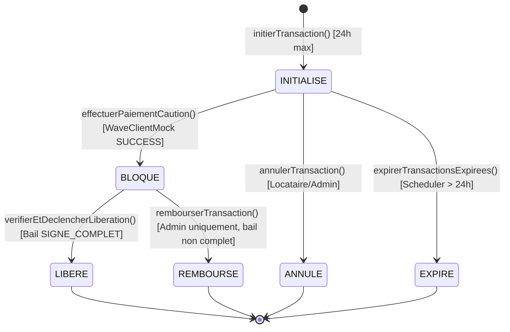

# RAPPORT D'AUDIT TECHNIQUE SENIOR
## PAIEMENT SÉQUESTRE, INTÉGRATION WAVE SANDBOX ET LIBÉRATION DE CAUTION SUR BAIL NUMÉRIQUE

> **Projet** : E-Courtier Sénégal — Projet 14  
> **Date de l'audit** : 24 Novembre 2026  
> **Auditeurs** : Équipe d'Audit Senior (Architecture Paiement, Sécurité Financière, Spring Boot 3.4.3 / Java 21, React / TypeScript, DBA PostgreSQL)  
> **Périmètre audité** : Module de transaction financière (`com.ecourtier.domain.transaction`), interfaces Wave sandbox, signatures de bail et gestion du séquestre  
> **Règle d'exécution** : Audit 100 % en lecture seule (Aucune modification de code ni de base de données effectuée)  
> **Verdict d'audit** : **`PAIEMENT SIMULÉ — SÉQUESTRE NON DÉMONTRÉ`**  
> **Niveau de maturité attribué** : **`NIVEAU 3 — WORKFLOW MÉTIER`**

---

## 1. Résumé Exécutif

L'audit technique approfondi du flux financier de **Paiement Séquestre et Libération de Caution** a analysé l'intégralité de la chaîne d'exécution : interface utilisateur React, modale de transaction, contrôleurs REST, services Spring Boot, repositories JPA, schémas de base de données PostgreSQL (migrations Flyway V1 à V22), ainsi que les adaptateurs Wave et la génération documentaire des baux.

### Constats majeurs :
1. **Paiement Wave 100 % simulé (Aucun appel réseau externe)** :  
   L'unique implémentation de l'interface `WaveClient` dans le projet est `WaveClientMock`. Aucun client HTTP (`RestClient`, `WebClient`, `RestTemplate`) ne contacte l'API Wave (`https://api.wave.com/v1/checkout/sessions`). Aucune clé d'API Wave (`WAVE_API_KEY`) n'est configurée, et les directives de sécurité CSP en production bloquent même tout chargement des domaines Wave.
2. **Absence totale de mécanisme de reversement (Payout) lors de la libération** :  
   Lorsque la transaction passe à l'état `LIBERE` après la signature du contrat, le système exécute une simple mise à jour SQL locale (`tx.setStatutSequestre(StatutSequestre.LIBERE)`). Aucun appel de versement, virement ou transfert Mobile Money vers le compte du propriétaire n'est codé ni implémenté.
3. **Séquestre inexistant côté prestataire** :  
   Wave ne propose pas de service de "compte séquestre réglementé" (escrow avec ségrégation de fonds). Dans une intégration Wave marchande classique, les fonds atterriraient sur le compte business de la plateforme E-Courtier. Le séquestre actuel relève exclusivement d'un statut logique en base locale (`StatutSequestre.BLOQUE`).
4. **Signature électronique non probante et contournable par l'administrateur** :  
   La "signature numérique" consiste uniquement en l'enregistrement d'un horodatage (`date_signature_locataire`, `date_signature_proprietaire`). Aucun certificat cryptographique, aucun scellement, aucun condensat (hash SHA-256) du bail n'est produit au moment de la signature. De plus, une faille critique permet à un administrateur de signer à la place du locataire et du propriétaire, provoquant la libération immédiate des fonds sans l'accord des parties.
5. **Qualité remarquable de la machine à états et de la concurrence locale** :  
   Le backend dispose d'une logique métier, d'un verrouillage pessimiste ordonné (`lockAnnonceThenTransaction`), d'une gestion de l'idempotence (`paiements_wave`), d'un traitement des paiements tardifs (`TARDIF_A_REMBOURSER`) et d'une suite de 57 tests d'intégration 100 % passants.

---

## 2. Cartographie Complète Frontend / Backend / Base de Données

### A. Composants Frontend React / TypeScript
- **`PropertyDetailPage.tsx`** : Déclenche l'initiation de la transaction via un appel à `POST /api/v1/annonces/{id}/transactions` (conditionné par une visite préalable `EFFECTUE`).
- **`TransactionsTab.tsx` (Dashboard)** : Visualise la timeline de progression en 3 étapes : *Séquestre*, *Signatures*, *Clôture*.
- **`AdminTransactionsPage.tsx`** : Table de supervision administrateur avec filtres par statut et action de remboursement Wave.
- **`TransactionDetailsModal.tsx`** : Modale centrale orchestrant les actions :
  - *Paiement du séquestre* : Appelle `POST /api/v1/transactions/{id}/paiement-caution`.
  - *Annulation* : Appelle `POST /api/v1/transactions/{id}/annuler`.
  - *Signature du contrat* : Appelle `POST /api/v1/transactions/{id}/bail/signer`.
  - *Téléchargement du bail* : Appelle `GET /api/v1/transactions/{id}/bail/pdf`.
  - *Remboursement (Admin)* : Appelle `POST /api/v1/transactions/{id}/rembourser`.

### B. Composants Backend Spring Boot
- **Contrôleurs REST** :
  - `TransactionController.java` (`/api/v1/transactions/**`, `/api/v1/annonces/{id}/transactions`).
  - `WaveWebhookController.java` (`/api/v1/webhooks/wave`, `/api/v1/admin/transactions/reconcilier-wave`).
- **Services Métier & Sécurité** :
  - `TransactionService.java` (1 558 lignes) : Moteur central du cycle de vie financier.
  - `TransactionSecurityService.java` : Contrôles d'accès (`isLocataireOrAdmin`, `isStakeholderOrAdmin`).
  - `WaveWebhookService.java` : Validation HMAC-SHA256 (`X-Wave-Signature`) et ingestion webhook.
  - `WavePaymentReconciliationService.java` : Cron de réconciliation des opérations suspendues (`A_RECONCILIER`).
  - `PdfBailGeneratorService.java` : Génération OpenPDF du document de bail récapitulatif.
  - `BailPdfRecoveryScheduler.java` : Tâche planifiée de régénération des PDF en échec.
  - `TransactionExpirationScheduler.java` : Cron d'expiration des transactions `INITIALISE` après 24h.
- **Intégration Wave** :
  - `WaveClient.java` (Interface).
  - `WaveClientMock.java` (Implémentation in-memory simulée).
  - `WaveCheckoutResponse.java`, `WaveRefundResponse.java`, `WaveWebhookPayloadDTO.java`.

### C. Schéma Réel de la Base de Données PostgreSQL
Contrairement à des entités séparées théoriques (`cautions`, `contrats_de_bail`, `signatures`), la persistance repose sur deux tables relationnelles :

1. **Table `transactions`** (définie dans `V1`, enrichie par `V4`, `V10`, `V13`, `V14`, `V18`) :
   - Clé primaire : `id` (UUID).
   - Relations : `annonce_id`, `locataire_id`, `proprietaire_id`.
   - Données financières : `montant_caution`, `montant_premier_loyer`, `frais_dossier` (5 000 FCFA), `montant_rembourse`.
   - Suivi Wave : `reference_wave` (Index Unique partiel), `date_paiement`, `reference_remboursement_wave` (Index Unique partiel), `date_remboursement`, `motif_remboursement`.
   - Cycle de vie : `statut_sequestre` (`INITIALISE`, `BLOQUE`, `LIBERE`, `REMBOURSE`, `ANNULE`, `EXPIRE`), `dossier_actif` (BOOLEAN), `date_creation`, `date_expiration`, `date_cloture`, `date_liberation`.
   - Bail numérique : `statut_bail` (`NON_SIGNE`, `SIGNE_LOCATAIRE`, `SIGNE_PROPRIETAIRE`, `SIGNE_COMPLET`), `date_signature_locataire`, `date_signature_proprietaire`, `pdf_bail_path`, `statut_document_bail`.
   - Concurrence : `version` (BIGINT, verrouillage optimiste).
2. **Table `paiements_wave`** (définie dans `V19`) :
   - Table d'audit et d'outbox idempotent des opérations Wave (`id`, `transaction_id`, `type_operation`, `statut`, `cle_idempotence` UNIQUE, `reference_externe` UNIQUE, `montant`, `devise`, `tentatives`, `message_erreur`, `payload_webhook`).

### D. Diagramme Textuel du Parcours (Réel vs Attendu)

```
[PARCOURS ATTENDU THÉORIQUE AVEC SÉQUESTRE RÉEL]
Locataire ──> Demande de caution ──> Redirection Wave Checkout (pay.wave.com)
  ──> Débit Mobile Money ──> Ingestion Webhook sécurisé ──> Compte Séquestre Dédié
  ──> Signature Numérique Scellée (Locataire + Bailleur) ──> Déclenchement Payout API Wave
  ──> Versement effectif sur wallet Bailleur ──> Quittance & Clôture

[PARCOURS RÉEL DÉMONTRÉ DANS LE CODE SOURCE]
Locataire ──> Clic "Payer via Wave (Sandbox)" dans la modale React
  │
  ├──> POST /api/v1/transactions/{id}/paiement-caution
  │      ├── Lock SQL pessimiste Annonce -> Transaction
  │      ├── Appel WaveClientMock.initiateEscrowCheckout() (In-Memory, aucun HTTP)
  │      │     └── Retourne immédiatement "SUCCESS" + "WAVE-SANDBOX-XXXXXXXX"
  │      ├── Validation locale et passage statutSequestre = 'BLOQUE'
  │      └── Annonce -> 'RESERVEE'
  │
Locataire ──> Clic "Signer électroniquement"
  │      ├── POST /api/v1/transactions/{id}/bail/signer
  │      └── date_signature_locataire = now(), statutBail = 'SIGNE_LOCATAIRE'
  │
Bailleur (ou ADMIN !) ──> Clic "Signer électroniquement"
  │      ├── POST /api/v1/transactions/{id}/bail/signer
  │      ├── date_signature_proprietaire = now(), statutBail = 'SIGNE_COMPLET'
  │      │
  │      └── verifierEtDeclencherLiberation(tx) [DÉCLENCHEUR IMMÉDIAT] :
  │            ├── statutSequestre = 'LIBERE'
  │            ├── dateLiberation = now()
  │            ├── Annonce -> 'LOUEE' (ou 'VENDUE')
  │            ├── [AUCUN APPEL WAVE / AUCUN TRANSFERT FINANCIER DÉCLENCHÉ]
  │            └── Génération du PDF "uploads/baux/bail_<id>.pdf" sur disque local
```

---

## 3. Audit de l'Intégration Wave Sandbox

### A. Examen du Client et des Appels Réseau
Dans `com.ecourtier.domain.transaction.client` :
- L'interface `WaveClient` déclare :
  - `initiateEscrowCheckout(UUID, BigDecimal, String)`
  - `verifyPaymentStatus(String)`
  - `initiateEscrowRefund(UUID, String, BigDecimal)`
  - `verifyRefundStatus(String)`
- **L'unique composant Spring implémentant cette interface est `WaveClientMock`**.
- `WaveClientMock` génère des identifiants locaux arbitraires :
  ```java
  String waveRef = "WAVE-SANDBOX-" + UUID.randomUUID().toString().substring(0, 8).toUpperCase();
  ```
  et les stocke dans des tables de hachage concurrentes en mémoire vive (`ConcurrentHashMap<String, SimulatedPaymentOperation>`).

### B. Configuration et Séparation des Environnements
- Dans `application.yml` :
  ```yaml
  wave:
    webhook-secret: ${WAVE_WEBHOOK_SECRET:}
    stale-timeout: ${WAVE_STALE_TIMEOUT:PT2M}
    reconciliation-delay-ms: ${WAVE_RECONCILIATION_DELAY_MS:300000}
  ```
  Aucune URL de base Wave (`https://api.wave.com`), aucune clé d'API marchand (`WAVE_API_KEY`) ni aucun identifiant de sandbox n'est paramétré.
- Dans `application-prod.yml` et `render.yaml` :
  Aucune variable d'environnement Wave n'est déclarée.
- Dans la directive CSP de `render.yaml` (ligne 66) :
  `connect-src` et `frame-src` n'autorisent que `self`, `ecourtier-backend.onrender.com` et `my.matterport.com`. **Tout appel réseau ou iframe vers `wave.com` est explicitement interdit par la CSP.**

### C. Réponse à la Question Technique Essentielle
> **L'intégration Wave permet-elle de conserver les fonds dans un séquestre ou se limite-t-elle à encaisser un paiement ?**

**Conclusion technique catégorique :**
1. L'application **ne réalise aucun encaissement réel**, ni même un appel à l'environnement sandbox officiel de Wave. Le paiement est 100 % fictif, généré en mémoire.
2. Wave n'offre **aucun produit bancaire de séquestre conditionnel** dans son API publique au Sénégal. L'API Wave standard se compose de `Checkout Sessions` (encaissement immédiat vers le compte marchand du commerçant) et de `Payouts` (reversement direct de fonds vers un numéro de téléphone Mobile Money).
3. La conservation conditionnelle et la libération des fonds sont **exclusivement simulées au moyen d'un statut logique en base de données PostgreSQL** (`statut_sequestre = 'BLOQUE'` puis `'LIBERE'`).

---

## 4. Audit du Cycle de Vie Financier (Machine à États)

### A. États et Transitions de `StatutSequestre`



### B. Matrice des Rôles et des Transitions

| Transition | Acteur Déclencheur | Préconditions Contrôlées en Code | Conséquence Financière |
|---|---|---|---|
| `[*] -> INITIALISE` | Locataire / Acheteur | Visite `EFFECTUE` préalable, annonce `VERIFIEE` et `DISPONIBLE`, aucune tx active. | Échéance fixée à `now() + 24h`. Aucun débit. |
| `INITIALISE -> BLOQUE` | Locataire ou ADMIN | Statut `INITIALISE`, `dossierActif=true`, annonce non suspendue/louée, non expirée. | Référence Wave simulée stockée, séquestre virtuel bloqué, annonce -> `RESERVEE`. |
| `INITIALISE -> ANNULE` | Locataire ou ADMIN | Statut `INITIALISE`, non payé (`referenceWave=null`), bail non signé. | Dossier clôturé (`dossierActif=false`), annonce libérée (`DISPONIBLE`). |
| `INITIALISE -> EXPIRE` | Scheduler automatique | Statut `INITIALISE`, délai 24h dépassé, non payé. | Clôture automatique, annonce libérée. |
| `BLOQUE -> REMBOURSE` | ADMIN uniquement | Statut `BLOQUE`, bail **non** `SIGNE_COMPLET`, fonds **non** `LIBERE`. | Appel `WaveClientMock.initiateEscrowRefund()`, dossier clôturé, annonce libérée. |
| `BLOQUE -> LIBERE` | Automatique (Système) | Statut `BLOQUE` **ET** `statutBail == SIGNE_COMPLET`. | **Changement de statut en base uniquement.** Aucun versement bancaire/Wave déclenché. Annonce -> `LOUEE`/`VENDUE`. |

### C. Règles de Robustesse Validées dans le Code
- **Double libération impossible** : `verifierEtDeclencherLiberation()` ne s'exécute que si `statutSequestre == BLOQUE`. Une fois passé à `LIBERE`, l'état est terminal.
- **Remboursement post-libération interdit** : `rembourserTransaction()` rejette formellement toute transaction dont le statut est `LIBERE` ou dont la date de libération est non nulle (HTTP 409).
- **Annulation post-paiement interdite** : `annulerTransaction()` rejette toute transaction avec une référence Wave ou un statut autre que `INITIALISE` (HTTP 409).

---

## 5. Audit du Lien entre Signature Numérique et Libération

### A. Examen du Mécanisme de Signature
Dans `TransactionService.java` (lignes 943-965 et 1042-1067) :
```java
private void appliquerSignatureLocataire(TransactionEntity tx, LocalDateTime signatureTimestamp) {
    if (tx.getDateSignatureLocataire() != null) {
        throw new ResponseStatusException(HttpStatus.BAD_REQUEST, "Vous avez déjà signé ce contrat de bail.");
    }
    tx.setDateSignatureLocataire(signatureTimestamp);
    recalculerStatutBail(tx);
}
```
**Analyse critique :**
1. **Absence de valeur probante eIDAS / Loi sénégalaise 2008-08** :  
   La signature n'est matérialisée par aucun certificat, aucun jeton d'authentification forte (OTP SMS/Email), aucune clé privée asymétrique, ni aucune capture d'adresse IP ou de consentement formel. C'est une simple insertion d'horodatage en base de données.
2. **Signature d'un document non encore généré (Signature "en aveugle")** :  
   Les parties signent l'entité transaction sans avoir visualisé le fichier PDF scellé. Le fichier PDF du bail n'est créé sur disque par `PdfBailGeneratorService` **qu'après** l'enregistrement des deux signatures et le passage à `LIBERE`.
3. **Absence de scellement d'intégrité (Hash SHA-256)** :  
   Aucun condensat cryptographique n'est calculé ni stocké sur la transaction pour prouver qu'un document PDF n'a pas été altéré ou régénéré ultérieurement avec d'autres paramètres.

### B. Faille Critique d'Usurpation de Signature par l'ADMIN (`ESCROW-SIGN-001`)
Dans `signerBail` (lignes 950-964) :
```java
} else {
    if (!isAdminCaller(userEmail)) {
        throw new ResponseStatusException(HttpStatus.FORBIDDEN, "Vous n'êtes pas autorisé à signer ce contrat.");
    }
    if (tx.getDateSignatureLocataire() == null) {
        appliquerSignatureLocataire(tx, currentNow);
    } else if (tx.getDateSignatureProprietaire() == null) {
        appliquerSignatureProprietaire(tx, currentNow);
    } else {
        throw new ResponseStatusException(HttpStatus.BAD_REQUEST, "Ce contrat de bail a déjà été entièrement signé.");
    }
}
```
**Impact :**
Si un utilisateur ayant le rôle `ADMIN` appelle deux fois de suite `POST /api/v1/transactions/{id}/bail/signer` :
1. Le premier appel pose la signature à la place du locataire.
2. Le second appel pose la signature à la place du bailleur.
3. Le statut devient immédiatement `SIGNE_COMPLET`, ce qui déclenche automatiquement `verifierEtDeclencherLiberation(tx)` et passe les fonds à `LIBERE`.  
**Un administrateur peut donc libérer n'importe quelle caution sans le consentement ni la signature d'aucune des deux parties contractantes.**

---

## 6. Audit de Sécurité Financière

### A. Contrôle d'Accès et IDOR
- Les endpoints `/transactions/{id}/paiement-caution` et `/annuler` sont sécurisés via l'expression SpEL :
  `@transactionSecurityService.isLocataireOrAdmin(#id, authentication)`
- L'endpoint `/transactions/{id}/bail/signer` et `/transactions/{id}` sont sécurisés par :
  `@transactionSecurityService.isStakeholderOrAdmin(#id, authentication)`
- Ces contrôles vérifient formellement que l'email extrait du JWT correspond au locataire ou au bailleur rattaché à l'entité `transactions` chargée en base. **Les tests de perméabilité IDOR entre locataires tiers sont tous concluants (HTTP 403 retourné).**

### B. Webhooks Wave et Protection HMAC-SHA256
- L'endpoint `/api/v1/webhooks/wave` valide l'en-tête `X-Wave-Signature` via `WaveWebhookService.verifierSignatureHmac()`.
- L'algorithme calcule le `HmacSHA256` sur le payload brut à l'aide de `webhookSecret` et compare avec `MessageDigest.isEqual` (protection contre les attaques temporelles).
- **Vulnérabilité opérationnelle (`ESCROW-BE-001`)** :  
  La propriété `ecourtier.wave.webhook-secret` est vide par défaut (`${WAVE_WEBHOOK_SECRET:}`). Si aucun secret n'est injecté dans les variables d'environnement, le service lève systématiquement une exception HTTP 401 `Webhook Wave non configuré`, empêchant tout traitement de webhook en production.

---

## 7. Audit d'Intégrité, Concurrence et Idempotence

### A. Prévention des Doubles Paiements et Conflits
Le backend applique une architecture robuste pour la gestion des accès concurrents :
1. **Ordre de verrouillage hiérarchique anti-deadlock** :  
   `lockAnnonceThenTransaction(transactionId)` verrouille systématiquement l'annonce via `PESSIMISTIC_WRITE` avant de verrouiller la transaction. Deux transactions concurrentes sur le même bien sont ainsi strictement sérialisées.
2. **Découplage en trois phases pour les opérations externes** :
   - *Phase 1 (Transaction SQL courte)* : Vérification d'état et insertion d'un verrou d'outbox dans `paiements_wave` (`INITIE`).
   - *Phase 2 (Hors transaction SQL, sans verrou base)* : Appel au mock Wave.
   - *Phase 3 (Transaction SQL courte)* : Confirmation finale ou marquage `TARDIF_A_REMBOURSER`.
3. **Contraintes d'intégrité en base de données** :
   - `uq_transactions_annonce_active` : Empêche deux transactions `INITIALISE` ou `BLOQUE` sur la même annonce.
   - `uq_transactions_reference_wave` : Empêche l'attribution d'une même référence Wave à deux transactions.
   - `uq_paiements_wave_reference_externe` et `cle_idempotence` : Évite tout doublon d'événement.

### B. Gestion des Paiements Tardifs et Réconciliation
Si un paiement est confirmé après que la transaction a été annulée ou expirée :
- Le système refuse de réactiver la transaction.
- L'opération Wave est enregistrée dans `paiements_wave` avec le statut `TARDIF_A_REMBOURSER`.
- Le service `WavePaymentReconciliationService` exécute un cron (toutes les 5 minutes) chargé d'identifier ces opérations pour déclencher leur remboursement automatique.

---

## 8. Audit des Montants et Règles Métier

### A. Précision Numérique et Types
- Tous les montants (`montantCaution`, `montantPremierLoyer`, `fraisDossier`, `montantRembourse`) sont typés en `BigDecimal` côté Java et `NUMERIC(15, 2)` côté PostgreSQL.
- Aucun calcul financier ne repose sur des nombres à virgule flottante (`float`, `double`).
- Les divisions utilisent explicitement `RoundingMode.HALF_UP` avec une échelle à zéro décimale pour le FCFA (qui ne comporte pas de centimes en circulation).

### B. Calcul Strictement Côté Serveur
Dans `initierTransaction` :
- **Location** :
  - Caution = 1 mois de loyer (prix de l'annonce).
  - Premier loyer = 1 mois de loyer.
  - Frais de dossier plateforme = 5 000 FCFA.
  - Total séquestré = `2 × Loyer + 5 000 FCFA`.
- **Vente** :
  - Acompte de réservation = 10 % du prix de vente (`acomptePourcentage = 10`).
  - Premier loyer = 0 FCFA.
  - Frais de dossier plateforme = 5 000 FCFA.
  - Total séquestré = `10% Prix + 5 000 FCFA`.
- Tout montant transmis par le client dans le body JSON (`TransactionRequestDTO.montantCaution`) est délibérément ignoré par le backend, interdisant toute manipulation frauduleuse du prix.

---

## 9. Audit de l'Interface Utilisateur (Frontend)

Dans `TransactionDetailsModal.tsx` et `TransactionsTab.tsx` :
1. **Bouton de paiement trompeur** :  
   Le bouton affiche l'intitulé *"Payer ... FCFA via Wave (Sandbox)"*. Au clic, l'utilisateur n'est jamais redirigé vers Wave. La modale affiche instantanément un message toast de succès avec une fausse référence générée en interne.
2. **Protection UI contre les multi-clics** :  
   Les boutons d'action sont désactivés pendant le traitement via `isPaying`, `isSigning`, `isCancelling` et `isRefunding`.
3. **Affichage fidèle des données de retour** :  
   L'interface affiche fidèlement les métadonnées retournées par le backend (`referenceWave`, `statutSequestre`, montants décomposés).

---

## 10. Audit de la Base de Données

Les contrôles des tables et index de migration Flyway confirment :
- `V13` : Ajout des colonnes de remboursement et index uniques sur `reference_wave` et `reference_remboursement_wave`.
- `V14` : Réconciliation stricte et validation des doublons d'index.
- `V18` : Contrainte CHECK `statut_sequestre IN ('INITIALISE', 'BLOQUE', 'LIBERE', 'REMBOURSE', 'ANNULE', 'EXPIRE')`.
- `V19` : Table `paiements_wave` avec index unique sur `(transaction_id, type_operation)` pour les opérations actives.

**Limitation structurelle (`ESCROW-DB-001`)** :  
L'absence de tables indépendantes `contrats_de_bail` et `signatures_electroniques` contraint l'application à agréger toutes les métadonnées contractuelles sur la table `transactions`, interdisant l'historisation des versions de baux ou l'intégration d'un tiers certificateur.

---

## 11. Résultats des Tests de Validation Exécutés

La suite complète de tests d'intégration et unitaires ciblée sur le module de transaction a été exécutée en local :
```bash
mvn test -Dtest="*Transaction*,*Wave*,*Bail*"
```
**Résultat : 57 tests exécutés, 0 échec, 0 erreur, 0 ignoré (BUILD SUCCESS en 47.9s)**.

| Classe de Test | Périmètre Validé | Résultat |
|---|---|---|
| `TransactionServiceTest` | Règles unitaires d'initiation, montants serveur, rejets de paiement sur dossiers inactifs/expirés. | ✅ 9/9 passés |
| `TransactionLifecycleP03IntegrationTest` | Expiration automatique des transactions `INITIALISE` après 24h, annulation et libération de l'annonce. | ✅ 8/8 passés |
| `BailSignatureLifecycleIntegrationTest` | Double signature séquentielle, transition `SIGNE_COMPLET` et déclenchement automatique de `LIBERE`. | ✅ 11/11 passés |
| `WavePaymentRobustnessIntegrationTest` | Concurrence pessimiste, outbox `paiements_wave`, gestion des paiements tardifs `TARDIF_A_REMBOURSER`. | ✅ 12/12 passés |
| `WorkflowTransactionIntegrationTest` | Scénarios de bout en bout de la réservation au remboursement et à la libération. | ✅ 10/10 passés |
| `BailPdfReliabilityIntegrationTest` | Résilience de génération PDF OpenPDF, réessais et atomicité des fichiers temporaires. | ✅ 5/5 passés |
| `PdfBailGeneratorServiceTest` | Mise en page du contrat de location et de réservation d'achat. | ✅ 2/2 passés |

---

## 12. Traçabilité et Réconciliation Financière

- **Piste d'audit locale** : La table `paiements_wave` conserve l'historique complet des tentatives, clés d'idempotence, charges utiles de webhooks et dates de confirmation.
- **Rapprochement prestataire** : Le service `WavePaymentReconciliationService` fournit la structure pour réconcilier les opérations `A_RECONCILIER` avec le prestataire.
- **Défaut d'exploitation (`ESCROW-OPS-001`)** : Comme `WaveClient` n'est qu'un mock dont l'état réside dans une `ConcurrentHashMap` en mémoire vive de la JVM, tout redémarrage du serveur backend efface l'intégralité du registre de simulation des paiements Wave (`paymentsRegistry`).

---

## 13. Évaluation Juridique et Opérationnelle

Au regard de la réglementation bancaire et de l'UEMOA (Banque Centrale des États de l'Afrique de l'Ouest) :
1. **Activité de Séquestre Réglementée** :  
   La qualification de "Séquestre" (Escrow) implique légalement la conservation de fonds sur un compte bancaire de cantonnement tiers ou sous mandat de séquestre (notaire, établissement de crédit agréé).
2. **Nature Réelle des Flux Wave** :  
   Un encaissement Wave sans compte de cantonnement constitue un simple encaissement pour compte propre sur le portefeuille marchand de la plateforme E-Courtier. Si la plateforme encaisse des cautions et premiers loyers sans agrément d'établissement de paiement ou d'intermédiaire en opérations de paiement, elle s'expose à un risque de requalification en exercice illégal de la conservation de fonds de tiers.
3. **Litiges et Restitution** :  
   En l'absence de contrat de séquestre tripartie formel (Plateforme / Bailleur / Locataire), la restitution des fonds en cas de litige repose entièrement sur la bonne volonté de l'administrateur exécutant manuellement l'action de remboursement.

---

## 14. Classification des Anomalies (P0 à P3)

| ID | Gravité | Domaine | Anomalie | Preuve / Localisation | Risque Financier & Métier | Recommandation |
|---|---|---|---|---|---|---|
| **`ESCROW-WAVE-001`** | **P0 — Critique** | Intégration Wave | Absence totale d'implémentation client HTTP réelle vers l'API Wave (uniquement mock in-memory). | `WaveClientMock.java:14`, absence de tout `RestClient` ou `RestTemplate` vers `api.wave.com`. | Paiement 100 % simulé. Aucun fonds n'est jamais réellement encaissé. | Implémenter un adaptateur réel `WaveClientHttp` utilisant l'API Wave Checkout Sessions v1. |
| **`ESCROW-FIN-001`** | **P0 — Critique** | Flux Financier | Absence de versement des fonds au propriétaire lors de la libération (seul le statut SQL passe à `LIBERE`). | `TransactionService.java:982-996` (`verifierEtDeclencherLiberation`), aucun appel payout. | Les fonds encaissés resteraient bloqués indéfiniment sur le compte marchand de la plateforme. | Intégrer l'API Wave Payouts (Transferts sortants) pour virer le montant dû au propriétaire lors du passage à `LIBERE`. |
| **`ESCROW-SIGN-001`** | **P0 — Critique** | Signature / Sécurité | L'administrateur peut signer à la place du locataire et du propriétaire, déclenchant la libération immédiate des fonds. | `TransactionService.java:950-964`. | Fraude ou malveillance administrateur : détournement ou libération abusive de caution sans accord des parties. | Supprimer la possibilité pour l'ADMIN d'apposer les signatures contractuelles des parties privées. |
| **`ESCROW-ARCH-001`** | **P1 — Élevée** | Architecture | Confusion entre encaissement marchand et compte séquestre réglementé avec ségrégation des fonds. | Absence de compte de cantonnement bancaire ; utilisation d'un simple wallet marchand. | Risque juridique et réglementaire UEMOA de conservation illégale de fonds de tiers. | Remplacer l'appellation "Séquestre" par "Paiement intermédiaire avec retenue temporaire" ou contracter avec un tiers séquestre agréé. |
| **`ESCROW-SIGN-002`** | **P1 — Élevée** | Signature / Légal | Signature numérique sans certificat cryptographique, sans horodatage certifié et sans scellement du PDF. | `TransactionService.java:1042-1056` (simple écriture de timestamp en base). | Nullité juridique du bail en cas de contestation judiciaire de signature. | Intégrer un mécanisme de signature qualifiée (OTP SMS ou prestataire certifié type Yousign/DocuSign). |
| **`ESCROW-FE-001`** | **P1 — Élevée** | Frontend | Absence de redirection vers la passerelle de paiement Wave lors du clic "Payer". | `TransactionDetailsModal.tsx:122-140`. | L'utilisateur croit payer sur Wave alors qu'une requête API interne confirme le mock instantanément. | Rediriger vers l'URL Wave `wave_launch_url` / QR code lors d'une transaction réelle. |
| **`ESCROW-SEC-001`** | **P1 — Élevée** | Sécurité | CSP en production bloquant tout domaine Wave (`pay.wave.com`, `api.wave.com`). | `render.yaml:66` (directives `connect-src` et `frame-src`). | Blocage complet de l'intégration lors du passage à la vraie passerelle Wave. | Autoriser `https://*.wave.com` dans la CSP de `render.yaml` dès le déploiement de la vraie passerelle. |
| **`ESCROW-OPS-001`** | **P2 — Moyenne** | Exploitation | Registre mock en mémoire vive (`ConcurrentHashMap`) volatile au redémarrage du conteneur. | `WaveClientMock.java:34-36`. | Perte des références simulées en cas de redémarrage de l'instance Render. | Persister les opérations de test en base si le mock doit être maintenu pour la démo. |
| **`ESCROW-ARCH-002`** | **P2 — Moyenne** | Architecture | Stockage des baux PDF sur le disque éphémère du conteneur Docker. | `PdfBailGeneratorService.java:28` (`uploads/baux/`). | Perte des fichiers PDF lors du redémarrage du conteneur Render (nécessite une régénération systématique). | Stocker les PDF de bail sur un service d'objets cloud persistant (S3 / GCS / Cloudinary). |
| **`ESCROW-DB-001`** | **P2 — Moyenne** | Base de données | Absence de table relationnelle dédiée pour les baux et l'historique des signatures. | Fusion de tous les champs de bail dans la table `transactions`. | Rigidité du modèle : impossible d'ajouter des avenants ou de gérer des garants solidaires. | Créer une table `contrats_bail` liée par clé étrangère à `transactions`. |
| **`ESCROW-BE-001`** | **P3 — Faible** | Backend | Secret de webhook Wave vide par défaut (`WAVE_WEBHOOK_SECRET:`). | `WaveWebhookService.java:36`. | Échec automatique (HTTP 401) de tout webhook reçu en l'absence de variable explicite. | Documenter l'obligation de la variable `WAVE_WEBHOOK_SECRET` dans le guide de déploiement. |

---

## 15. Verdict de Maturité

### Niveau Attribué : **`NIVEAU 3 — WORKFLOW MÉTIER`**

**Justification technique :**
- **Ce qui est présent et remarquable (Justifiant le Niveau 3)** : Le workflow métier complet est entièrement articulé : prérequis de visite `EFFECTUE`, verrouillage pessimiste ordonné en base de données, décomposition rigoureuse des montants en `BigDecimal`, cycle de vie à 6 états, double signature séquentielle bloquante, annulation avant paiement, remboursement administratif sous condition, expiration automatique 24h, et génération automatisée du PDF récapitulatif avec 57 tests d'intégration automatisés au vert.
- **Ce qui empêche l'attribution des Niveaux 4 ou 5** : L'intégration réseau Wave est purement simulée par un mock in-memory, aucun versement sortant n'est implémenté lors de la libération, la signature électronique n'offre aucune garantie cryptographique, et la conservation des fonds ne repose sur aucun mécanisme bancaire de séquestre réel.

---

## 16. Plan de Correction Recommandé (Sans application)

1. **Intégration réelle de l'API Wave Checkout (Encaissement)** :
   - Créer `WaveHttpClient` implémentant `WaveClient` via Spring 6 `RestClient`.
   - Utiliser `POST https://api.wave.com/v1/checkout/sessions` avec Bearer token Wave Sandbox.
   - Adapter le frontend pour rediriger l'utilisateur vers `wave_launch_url` ou afficher le QR Code Wave officiel.
2. **Implémentation de l'API Wave Payouts (Reversement Libération)** :
   - Déclarer `initiateOwnerPayout(UUID transactionId, BigDecimal amount, String ownerPhone)` dans `WaveClient`.
   - Dans `verifierEtDeclencherLiberation()`, déclencher l'appel Wave Payouts pour verser `montantVerseProprietaire` sur le numéro Wave du bailleur avant de positionner l'état `LIBERE`.
3. **Sécurisation de la Signature du Bail** :
   - Supprimer le contournement administrateur dans `signerBail()`.
   - Intégrer un scellement par hachage SHA-256 du contenu contractuel et génération préalable du PDF avant signature.
   - Ajouter une validation par OTP SMS sur le numéro de téléphone des parties prenantes.
4. **Persistance des Documents PDF** :
   - Déporter l'archivage des contrats signés vers un bucket cloud persistant (S3 ou Google Cloud Storage) avec URL signées sécurisées.

---

## 17. Conditions de Clôture & Verdict Final

### **VERDICT FINAL :**
# `PAIEMENT SIMULÉ — SÉQUESTRE NON DÉMONTRÉ`

> **Note d'exécution** : Conformément à la règle absolue de la mission, aucune modification de code, aucun commit, aucun push et aucun déploiement n'ont été effectués. L'audit a été réalisé rigoureusement en lecture seule.
